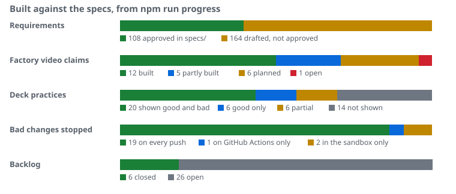

# who-gets-the-keys

[](https://github.com/PaulDuvall/who-gets-the-keys/actions/workflows/pipeline.yml?query=branch%3Amain)
[](https://github.com/PaulDuvall/who-gets-the-keys/actions/workflows/scenarios.yml)
[](stryker.config.json)
[](package.json)
[](https://github.com/PaulDuvall/who-gets-the-keys/commits/main)
[](#progress)
[](#progress)
[](LICENSE)

Companion repo to the talk “Who Gets the Keys?”: an AI agent writes the code, the pipeline holds the keys, and 22 deliberately bad changes are stopped before they ship.

| | |
|---|---|
| Rule demonstrated | Bad changes never reach production, because the pipeline prevents them |
| Good scenario | `main`, always green |
| Bad scenarios | 22 scenarios (B1 to B18, with B8 split into B8a and B8b, then B23, B24 and B81), each failing at one named check with one expected line. 19 are patches against `main`; B9 replays an issue fixture, B11 is an AWS call and B24 is a task file alone |
| Source of record | Talk deck "Who Gets the Keys? Trust and Authority in Software Factories" (AI Native DevCon 2026), pinned at `specs/source-of-record/slides.txt` |
| Recorded talk | [Who Gets the Keys in a Software Factory?](https://youtu.be/IG-dgFh1wNM), on the AI Native Dev YouTube channel |
| Status | All 15 checks and 19 local scenarios pass on `main`. The repo is public, and the attest job has signed builds since 2026-11-02. Each deploy to the AWS sandbox runs from `main` after the `sandbox` reviewer approves it; deploys have run since 2026-11-07. The sandbox-account scenarios (B11, B14) have not been recorded |

Coding agents now change code faster than anyone can read the diffs. The talk argues that human review after the code exists was never the control, so the deployment pipeline has to hold the keys. This repo runs that argument end to end. Claude Code wrote a small export service. A pipeline of 15 checks guards it, and 22 deliberately bad changes show each control holding, from a test that asserts nothing to a poisoned GitHub issue. It is for engineering, platform and security leads deciding how far to trust agent-written code, and for anyone who saw the talk and wants to see the practices run.

## Progress

What is built against what the specs and decisions describe, generated by `npm run progress` into [docs/progress.json](docs/progress.json) and the picture below. A test fails when either is stale, so it changes with every landing (SPEC-001-R226 to R229).



| Bar | Built | Still to build |
|---|---|---|
| Requirements | Rows in `specs/`, each with a test (the trace check) | Rows drafted in `docs/decisions/` or in staged spec copies under `proposals/`, not yet approved |
| Factory video claims | Claims in `factory-video/claims.json` that cite approved requirements | Claims that cite drafts (planned) or backlog items (open). The video shows the whole target, then an end card outlines what is left |
| Deck practices | Practices in `practices.yaml` shown with a good and a bad case, or a good case | Partial and not-shown practices, each with its reason in [docs/practices.md](docs/practices.md) |
| Bad changes stopped | Scenarios that run on every push to `main` | The ones that need GitHub Actions or the sandbox account run on demand |

## Quick start

```bash
git clone https://github.com/PaulDuvall/who-gets-the-keys.git
cd who-gets-the-keys
npm ci --ignore-scripts
npm run checks
npm run scenarios
```

| Command | Result |
|---|---|
| `npm run checks` | Runs every check fail-fast; exits 0 on `main` |
| `npm run check:<name>` | Runs one check |
| `npm run scenarios` | Applies each local bad patch in a temporary worktree and asserts its check and line |
| `npm run scenario -- B12` | Runs one scenario |
| `npm run video` | Builds the narrated walkthrough into `build/video/` |
| `npm run video -- --page-only` | Builds the walkthrough page alone, no browser |
| `npm run practices` | Regenerates `docs/practices.md` from `practices.yaml` |

## Prerequisites

| Tool | Version | Needed for |
|---|---|---|
| [Node.js](https://nodejs.org/) | [24.x](https://nodejs.org/en/about/previous-releases) (`engines`) | everything |
| [gitleaks](https://github.com/gitleaks/gitleaks) | [8.30.1](https://github.com/gitleaks/gitleaks/releases/tag/v8.30.1) | `check:secrets` |
| [zizmor](https://docs.zizmor.sh/) | [1.31.1](https://pypi.org/project/zizmor/1.31.1/) | `check:workflows` |
| [Terraform](https://developer.hashicorp.com/terraform), [tflint](https://github.com/terraform-linters/tflint) | [1.16.6](https://releases.hashicorp.com/terraform/1.16.6/), [0.64.0](https://github.com/terraform-linters/tflint/releases/tag/v0.64.0) | `check:iac` |
| [Semgrep](https://semgrep.dev/docs/) | [1.181.0](https://pypi.org/project/semgrep/1.181.0/) | `check:sast` |
| [OSV-Scanner](https://github.com/google/osv-scanner) | [2.7.0](https://github.com/google/osv-scanner/releases/tag/v2.7.0) | `check:sca` |
| [ssh-keygen](https://man.openbsd.org/ssh-keygen) | [OpenSSH](https://www.openssh.com/) 8.2 or later; to sign approver commits, 8.4 or later with security-key support (Homebrew's on macOS) | `check:signatures` |
| [ffmpeg](https://ffmpeg.org/), [ffprobe](https://ffmpeg.org/ffprobe.html), [Xvfb](https://www.x.org/releases/X11R7.7/doc/man/man1/Xvfb.1.xhtml), [uv](https://docs.astral.sh/uv/) | system | `npm run video` |

Versions, sources and dates: [docs/verification.md](docs/verification.md).

## Checks

A check is automated. A gate is a human approval: an approver-signed commit, or a required reviewer's approval of a deployment to the `sandbox` or `probe` environment.

`npm run checks` runs them in this order and stops at the first failure. Every failure prints one line: `CHECK <name> FAILED: <identifier>`.

| # | Check | Tool | Fails when |
|---|---|---|---|
| 1 | secrets | [gitleaks](https://github.com/gitleaks/gitleaks) | A secret is in the working tree |
| 2 | allowlist | `package.json` scan | A dependency name is not in `allowed-deps.txt` |
| 3 | workflows | [zizmor](https://docs.zizmor.sh/) + script | Any zizmor finding; a cache in `pipeline.yml` (`deploy-cache`); or the B9 replay job's permissions or egress differ from the triage job's (`replay-parity`) |
| 4 | install | [`npm ci --ignore-scripts`](https://docs.npmjs.com/cli/commands/npm-ci) | The lockfile does not install |
| 5 | lint | [ESLint](https://eslint.org/), [typescript-eslint](https://typescript-eslint.io/), [`@vitest/eslint-plugin`](https://github.com/vitest-dev/eslint-plugin-vitest) | Any error, including a test with no assertion |
| 6 | typecheck | [`tsc --noEmit`](https://www.typescriptlang.org/docs/handbook/compiler-options.html) | Any type error under strict settings |
| 7 | iac | [`terraform fmt`](https://developer.hashicorp.com/terraform/cli/commands/fmt), [`validate`](https://developer.hashicorp.com/terraform/cli/commands/validate), [tflint](https://github.com/terraform-linters/tflint) | `infra/sandbox` or `infra/org` fails a check |
| 8 | sast | [Semgrep `p/default`](https://semgrep.dev/p/default) | Any finding |
| 9 | sca | [OSV-Scanner](https://github.com/google/osv-scanner) | A known vulnerability in any npm or Python lockfile, unless `specs/sca-exceptions.toml` lists it and its `ignoreUntil` has not passed |
| 10 | trace | git + script | No `Spec:` trailer, a requirement with no test, or an export with no `@requirement` |
| 11 | signatures | [`git verify-commit`](https://git-scm.com/docs/git-verify-commit), then the signature's flags | An unsigned change to `specs/`, `approvers.txt` or a protected path. An approver signature without a touch: touch only for now, per the owner decision of 2026-11-05. A key in `approvers.txt` that is not a security key |
| 12 | slides | script | `practices.yaml` disagrees with the pinned slide snapshot |
| 13 | ratchet | script | Stryker `thresholds.break` is below the highest value it has had in any commit |
| 14 | test | [Vitest](https://vitest.dev/) | Any test fails |
| 15 | mutation | [Stryker](https://stryker-mutator.io/) | Mutation score below `thresholds.break` (95) |
| receipt | receipt | [`gh attestation verify`](https://cli.github.com/manual/gh_attestation_verify) + script | The build provenance or the receipt predicate does not verify for this commit, ref and artifact, or its record is malformed (`unpinned ref`, `unpinned commit`, `missing <predicate type>`). Runs in the receipt job, after build and attest, on every candidate and `main` push |
| deploy | deploy-tip | [`git ls-remote`](https://git-scm.com/docs/git-ls-remote) + script | The run's commit is not `main`'s current tip, or the tip cannot be read: `CHECK deploy-tip FAILED: <first 12 characters of the commit SHA>`. Runs first, before the artifact is read or AWS is called, so an approval given to an older run deploys nothing (SPEC-001-R190) |
| deploy | attestation | [`gh attestation verify`](https://cli.github.com/manual/gh_attestation_verify) | The artifact has no valid attestation |
| deploy | receipt | as above, pinned to `refs/heads/main` | The receipt check again, after attestation and before any AWS call (SPEC-001-R56) |
| deploy | irreversible | [`terraform show -json plan.out`](https://developer.hashicorp.com/terraform/cli/commands/show) | A stateful resource would be deleted without an approver-signed commit |
| after 15 | task | `git show` + script | A `Task:` trailer in the range names a task file that is missing or malformed at the merge base with `main`, or that cites a requirement no spec defines |
| after 15 | scope | `git diff-tree` + script | A commit with a `Task:` trailer touches a path outside its task's `produces`, a protected path, `specs/`, `tasks/` or `approvers.txt`, names another task, or names a requirement its task does not cite |

## Scenarios

| ID | Bad thing attempted | Stopped by | Slide |
|---|---|---|---|
| B1 | Test with no assertion | lint | 5, 12 |
| B2 | Weak assertion | mutation | 5, 7 |
| B3 | Code change with no spec ID | trace | 3, 13 |
| B4 | Agent rewrites acceptance criteria to fit its code | signatures | 3, 11 |
| B5 | Hard-coded secret | secrets | 4 |
| B6 | Invented package name | allowlist | 6, 12 |
| B7 | Guardrail loosened | ratchet | 8 |
| B8a | Cache in a deploy job | workflows | 9, 10 |
| B8b | Action pinned by tag | workflows | 10 |
| B9 | Poisoned issue #4821 | boundary | 6, 9, 12 |
| B10 | Unattested artifact reaches deploy | attestation | 7, 13 |
| B11 | Non-deploy principal writes the sandbox | boundary (SCP) | 10 |
| B12 | Command injection in your code | sast | 4 |
| B13 | Command injection in imported code | sca | 4 |
| B14 | Irreversible change without approval | irreversible | 8, 10 |
| B15 | Requirement with no test | trace | 7, 13 |
| B16 | Capability with no requirement | trace | 7, 13, Q3 |
| B17 | Tampered source of record | signatures | 6 |
| B18 | Agent loosens the pipeline without a signature | signatures | 8, Q3 |
| B23 | Change outside the task's scope | scope | 8, 11 |
| B24 | Task citing an unapproved requirement | task | 3, 8 |
| B81 | Agent makes npm load its own code before the checks | signatures | 8 |

Expected lines and patches: `scenarios/scenarios.yaml`. B9's AWS checks, B11 and B14 need the sandbox account and run on demand.

## Who holds which keys

| Principal | Can | Cannot |
|---|---|---|
| Agent (Claude Code) | Write code, tests and docs; propose spec, pipeline and dependency changes in `proposals/` | Sign commits, write `specs/` or any path in `specs/protected-paths.txt`, deploy, hold cloud credentials, loosen guardrails |
| Human approver | Sign spec changes and irreversible changes, with a security key and a touch each time, touch only for now per the owner decision of 2026-11-05; use break-glass | Deploy outside the pipeline without raising an alarm |
| `pipeline.yml` deploy role | Plan and apply `infra/sandbox` from environment `sandbox` | Be assumed from any other workflow, ref or environment |
| Triage role | Invoke Bedrock models; the triage agent returns one label from a fixed schema | Write to the repo or post text; run a shell; reach the network beyond an allowlist |
| Scenario probe role | Read state (`ReadOnlyAccess`) | Write: its one Lambda write grant exists so B11 can show the SCP deny it |
| Break-glass role | Write, alarmed | Be assumed by anyone but the break-glass user, and by that user only with a TOTP code from the owner's YubiKey |
| Break-glass user | Assume the break-glass role with a TOTP code, through `us-east-1`; every call it makes is alarmed | Anything else: its own policy denies every other action and every other role |

## Tool choices compared with the deck

The deck's speaker notes name example tools for each practice. Where this repo uses something else, this table says what and why.

| Practice | The deck names | This repo uses | Why |
|---|---|---|---|
| SAST, SCA, secrets | [Semgrep](https://semgrep.dev/docs/) or [CodeQL](https://codeql.github.com/); [OSV-Scanner](https://github.com/google/osv-scanner), [Trivy](https://github.com/aquasecurity/trivy) or [Snyk](https://snyk.io/); [gitleaks](https://github.com/gitleaks/gitleaks) or [TruffleHog](https://github.com/trufflesecurity/trufflehog) | [Semgrep](https://semgrep.dev/docs/), [OSV-Scanner](https://github.com/google/osv-scanner), [gitleaks](https://github.com/gitleaks/gitleaks) | The first tool the deck names for each |
| Mutation and property tests | [Stryker](https://stryker-mutator.io/) or [PIT](https://pitest.org/); [fast-check](https://fast-check.dev/) or [Hypothesis](https://hypothesis.readthedocs.io/) | [Stryker](https://stryker-mutator.io/), [fast-check](https://fast-check.dev/) | TypeScript repo |
| Runner egress control | [StepSecurity Harden-Runner](https://github.com/step-security/harden-runner) | Anthropic [`srt`](https://github.com/anthropics/sandbox-runtime) and [Claude Code sandbox settings](https://code.claude.com/docs/en/sandboxing), both from `.github/egress/allowlist.json` | Chosen while the repo was private, when Harden-Runner block mode needed a paid plan (D04). The repo is public now, and StepSecurity's free Community Tier, for public repositories only, lists block mode with an allow list on GitHub-hosted runners ([docs](https://docs.stepsecurity.io/harden-runner), checked 2026-11-08). The repo has not switched |
| Codified policy checks | [Open Policy Agent](https://www.openpolicyagent.org/) with [Conftest](https://www.conftest.dev/), or [Cedar](https://www.cedarpolicy.com/) | `scripts/checks.ts`, one function per check | One language for repo code; each check prints one failure line |
| Specs and acceptance criteria | [Tessl](https://tessl.io/), [GitHub Spec Kit](https://github.com/github/spec-kit) or [Kiro](https://kiro.dev/); [Cucumber](https://cucumber.io/) | EARS-style tables in `specs/`; [Vitest](https://vitest.dev/) tests titled by requirement ID | The trace check verifies both directions without another toolchain |
| Spec and pipeline approval | [CODEOWNERS](https://docs.github.com/en/repositories/managing-your-repositorys-settings-and-features/customizing-your-repository/about-code-owners), [rulesets](https://docs.github.com/en/repositories/configuring-branches-and-merges-in-your-repository/managing-rulesets/about-rulesets), [GitHub Environments](https://docs.github.com/en/actions/managing-workflow-runs-and-deployments/managing-deployments/managing-environments-for-deployment) required reviewers | Approver-signed commits, checked by the signatures check for `specs/`, `approvers.txt` and every path in `specs/protected-paths.txt` | Trunk-based with no pull requests, so approval is a signature the pipeline verifies |
| Attestation verification | [Kyverno](https://kyverno.io/) or [Sigstore policy-controller](https://github.com/sigstore/policy-controller); [cosign](https://github.com/sigstore/cosign) | [GitHub artifact attestations](https://docs.github.com/en/actions/concepts/security/artifact-attestations), verified by [`gh attestation verify`](https://cli.github.com/manual/gh_attestation_verify) before any AWS call | The deploy target is a Lambda, not Kubernetes; deploy fails closed without a valid attestation (B10) |
| Waivers with an expiry | Snyk ignore, Trivy `expired_at`, OPA exceptions | [OSV-Scanner `ignoreUntil`](https://google.github.io/osv-scanner/configuration/) entries in `specs/sca-exceptions.toml`, owner-signed | OSV-Scanner is the SCA tool |
| Dependency intake | [CodeArtifact](https://aws.amazon.com/codeartifact/), Artifactory or Socket; [pip `--require-hashes`](https://pip.pypa.io/en/stable/topics/secure-installs/), [`npm ci`](https://docs.npmjs.com/cli/commands/npm-ci) | `allowed-deps.txt`, lockfile hashes, [`npm ci`](https://docs.npmjs.com/cli/commands/npm-ci), [pip `--require-hashes`](https://pip.pypa.io/en/stable/topics/secure-installs/) | No private mirror in a demo repo |
| Break-glass | [TEAM for IAM Identity Center](https://github.com/aws-samples/iam-identity-center-team); [CloudTrail](https://aws.amazon.com/cloudtrail/) plus an [EventBridge](https://aws.amazon.com/eventbridge/) alarm | A separate IAM role, assumed only by its own IAM user with a TOTP code from a YubiKey, and an [EventBridge](https://aws.amazon.com/eventbridge/) alarm to email | One sandbox account; an Identity Center session carries no MFA flag (decision 0007) |
| Not shown | DAST ([ZAP](https://www.zaproxy.org/), [StackHawk](https://www.stackhawk.com/)), [CloudWatch Logs data protection](https://docs.aws.amazon.com/AmazonCloudWatch/latest/logs/mask-sensitive-log-data.html), [OpenTelemetry](https://opentelemetry.io/) redaction, [IAM Access Analyzer](https://aws.amazon.com/iam/access-analyzer/), [Security Hub](https://aws.amazon.com/security-hub/), [GuardDuty](https://aws.amazon.com/guardduty/), [CodeDeploy](https://aws.amazon.com/codedeploy/) or [Argo Rollouts](https://argoproj.github.io/rollouts/) | none | The repo shows the pipeline, not a running production service; see `docs/slide-reconciliation.md` |

## Repository map

| Path | Holds |
|---|---|
| `specs/` | Approved requirements (SPEC-001, SPEC-002, SPEC-014), SCA exceptions (`sca-exceptions.toml`) and the slide snapshot. Approver-signed commits only |
| `proposals/` | Agent-proposed spec changes, awaiting a signed move into `specs/` |
| `approvers.txt` | SSH allowed-signers file for approvers |
| `allowed-deps.txt` | Package names the allowlist check accepts |
| `practices.yaml` | Slide practice → check, scenario and files |
| `traceability.md` | Requirement → test file → check → scenario |
| `src/`, `test/` | Export service and its acceptance, property and unit tests |
| `scripts/checks.ts` | Check dispatcher |
| `scripts/bootstrap/` | Scripts the owner runs: GitHub settings, AWS bootstrap, slide refresh |
| `scenarios/` | Scenario definitions, patches, fixtures and harness |
| `tasks/` | Approver-signed task files: what one delivery may change, and why |
| `.github/workflows/` | `pipeline.yml`, `issue-triage.yml`, `scenarios.yml`, `video.yml` |
| `infra/sandbox/`, `infra/org/` | Terraform for the workload and roles; the SCP |
| `video/` | Walkthrough page template, orchestrator, recorder and narration pins |
| `factory-video/` | The software-factory scene for the talk: guided video, loop, poster and the claims ledger. The videos are built by the `factory-video` workflow, not committed |
| `.claude/` | Settings (deny rules, env, hooks), hook script, subagents, the video skill |
| `CLAUDE.md` | Conventions and authority boundaries for Claude Code sessions |

## How changes land

`main` only moves to a commit whose checks passed (SPEC-001-R41). Each change goes to `candidate/<topic>`, its checks pass there, and that same SHA goes to `main`. The deploy from `main` then waits for the `sandbox` reviewer's approval, a gate. The agent lands its own commits to unprotected paths this way, unsigned, as `CLAUDE.md` says. The owner lands each staged batch of protected files in `proposals/` as one signed commit, with `scripts/bootstrap/land.sh`.

`scripts/bootstrap/land.sh proposals/<batch> [--stop-before-main]` moves the files that the batch's `LAND.txt` lists and shows the diff. After your review, and before it asks you to sign, it tests the moved tree in a temporary worktree, from an empty environment: Node.js against `package.json`'s `engines`, `npm ci --ignore-scripts`, `tsc`, ESLint on the moved code, every test, the trace check, and `git apply --check` on each scenario patch the batch moves or touches. That is the preflight that used to be a pasted one-liner. If any step fails, it signs nothing (SPEC-001-R213). Your security key must not blink during it. It asks for your review, one security-key tap and then, in GitHub, your approval of the sandbox deploy. When the deploy waits, it prints the run's URL to approve it at, and keeps it on screen until you do. If only the deploy was cancelled, or rejected, it says so. In between, it pushes the commit to `candidate/land-<batch>`, waits for that run, pushes the same SHA to `main` and deletes the candidate branch. If a run fails, fix it in a new commit on top; never amend. `--stop-before-main` stops after the candidate run and prints the `--to-main` command that finishes the landing.

A runner producer delivery is unsigned and touches only unprotected paths, but its branch has no counted checks: the publish job pushes it with the `GITHUB_TOKEN`, which starts no run. `scripts/bootstrap/land.sh --delivery candidate/<task>` shows the delivery and, on a yes, pushes the same commit to `candidate/<task>-owner`, waits for that run and moves `main` (SPEC-001-R210). The publish job prints the command.

To start the producer, run `scripts/bootstrap/producer.sh task <task> --subject <subject>` for a signed task file, or `scripts/bootstrap/producer.sh probe` for the egress probe, from your `main` at `origin/main`. It dispatches `producer.yml`, takes the run the dispatch started, watches it, and judges it from GitHub's record of the run and its steps, never from log text, which also holds the agent's output. It prints the producer's own result lines: the permission mode, any `BOUNDARY` or `CHECK` line, the publish job's `Pushed` line and how the agent's run ended; and for a task that passed, the `land.sh --delivery` command. It exits 1 unless the run passed (SPEC-001-R212).

## AWS setup

The sandbox must be a member account of your AWS Organization, not its management account. SCPs do not affect the management account, so B11's SCP denial would not hold there. AWS also advises against running workloads in it.

`scripts/bootstrap/aws-setup.sh` does the whole AWS setup as one command. It needs admin CLI profiles for the sandbox account and the management account. It also needs [AWS CLI](https://aws.amazon.com/cli/) v2 with `create-bucket --bucket-namespace`, [Terraform](https://developer.hashicorp.com/terraform) 1.11 or later, [Node.js](https://nodejs.org/) 24.11 or later, zip, [OpenSSL](https://www.openssl.org/), [jq](https://jqlang.org/) and a signed-in [gh](https://cli.github.com/).

Run it from a clean checkout of `main`: it refuses to start if the working tree has changes or `HEAD` is not `origin/main`. `SANDBOX_ACCOUNT_ID` can also come from your shell profile, so the account number never has to appear in a command you paste:

```bash
SANDBOX_ACCOUNT_ID=111122223333 SANDBOX_PROFILE=sandbox MANAGEMENT_PROFILE=management ALERT_EMAIL=you@example.com scripts/bootstrap/aws-setup.sh
```

It first checks the tools, the working tree, both accounts, the organization and Bedrock. If a check fails, it says what to fix and changes nothing. Then it asks once. After that it pauses only to show each Terraform plan before applying that saved plan, and to remind you to confirm the alert email.

It runs `aws.sh`, the two Terraform applies, the alert subscription, the break-glass user's enrollment (below) and `github.sh --vars`. Set `TRIAGE_MODEL` to skip picking a Bedrock model from a list, and `BEDROCK_FORM` to submit the Anthropic first-time-use form. A rerun skips what exists. Each backend is set up with `-reconfigure`, so no state moves over from an account used before, and resources there stay as they are. When it finishes, approve the sandbox deploy in `main`'s tip run in GitHub, never an older run's. If that deploy already ran and failed, rerun the run's failed jobs with `gh run rerun <run ID> --failed`, then approve.

### Break-glass

SPEC-001-R217, `docs/decisions/0007-break-glass-mfa.md`. The first enrollment needs the SCP lifted once: the steps are in `docs/notes/break-glass-mfa.md`.

Break-glass is the only identity that can change the workload's roles once the SCP is attached. Only one principal may assume it: IAM user `who-gets-the-keys-break-glass-user`, with a TOTP code, through `us-east-1`. An IAM Identity Center session cannot: it is federated, so it carries no MFA flag. The user's access key can do nothing else, and every call it makes, and every assumption of break-glass, emails `ALERT_EMAIL`. The alert needs a CloudTrail trail that logs read and write management events, and its topic is encrypted with a key of its own that EventBridge may use: under the AWS managed key no alert was ever delivered, until 2026-11-10 (`docs/notes/alarm-key.md`). A refused attempt by any other identity to assume break-glass sends no email yet: CloudTrail records it without the role in its request parameters, so the rule does not match it (backlog `who-gets-the-keys-r3m`).

You need a YubiKey with the OATH application enabled (`ykman info` lists it) and `ykman`. AWS takes no FIDO2 key for this. Any RFC 6238 authenticator app works instead.

Step 5 of `aws-setup.sh` enrolls the user while the SCP is not attached, which is on a first setup or after you lift it:

1. It creates the TOTP device and writes its secret to a file only you can read. You add it to the YubiKey with the `ykman oath accounts add --touch` command it prints.
2. It asks for two codes, one after the other, each from `ykman oath accounts code --single who-gets-the-keys-break-glass-user` and a touch.
3. It creates one access key into profile `who-gets-the-keys-break-glass-user`, without printing it, and writes profile `who-gets-the-keys-break-glass` with `mfa_serial`. Set `BREAK_GLASS_PROFILE` for other names.

Once the SCP is attached, check it once. It asks for a code and sends an alert email:

```bash
aws sts get-caller-identity --profile who-gets-the-keys-break-glass --region us-east-1
```

The trust allows the assumption only through `us-east-1`, and an `AWS_REGION` in your shell overrides the profile's region, so the command names it.

To apply `infra/sandbox` as break-glass, use the commands `scripts/bootstrap/aws.sh` prints in its step 4: Terraform cannot ask for an MFA code, so the AWS CLI asks and hands Terraform the role's credentials. Rotate the access key every 90 days as break-glass, without lifting the SCP. A lost YubiKey needs the SCP lifted and step 5 run again. Decision 0007 lists the commands for both.

## Cloud session environment

Claude Code cloud sessions for this repository run in a claude.ai cloud environment. Its settings live in claude.ai, not here, and nothing versions them (`docs/notes/tracer-2.md`, "Why"). This section is the record of what it holds, so it can be rebuilt from the repo. Edit it in the cloud environment menu in a session's title bar, then Edit. A new setup script runs when a fresh container is built, not when a session resumes.

| Setting | Value |
|---|---|
| Name | who-gets-the-keys (personal) |
| Repositories | None preselected |
| Network access | Full. The script fetches from nodejs.org, github.com release downloads, releases.hashicorp.com, PyPI and the npm registry; a limited network has not been tried |
| Network secrets | None |
| Environment variables | None |
| Setup script | The one line below. It runs as root, from the directory that holds the checkout |

```bash
if [ -f who-gets-the-keys/scripts/bootstrap/cloud-session-setup.sh ]; then bash who-gets-the-keys/scripts/bootstrap/cloud-session-setup.sh; fi
```

The script it calls is [`scripts/bootstrap/cloud-session-setup.sh`](scripts/bootstrap/cloud-session-setup.sh), a protected path, so a change to it needs an approver-signed commit (SPEC-001-R211). It gives a session the Node.js version `package.json` pins (the image ships Node 22), checked against the SHA-256 that `docs/verification.md` records; the pinned check CLIs from `scripts/ci/install-tools.sh`; and `node_modules` from the lockfile with install scripts off. `/root/.local/bin` comes before `/opt/node22/bin` on the image's `PATH`. With it, a session can run `tsc`, ESLint, vitest and the other local checks, and the commit hook finds gitleaks. The agent installs nothing: `.claude/settings.json` still denies it `npm ci`, and the claude.ai environment, not the agent, runs the script. The `-f` test keeps a session on a branch older than the script starting, with nothing installed. The script's lines, then in this README, were run twice in a session container on 2026-11-07: Node v24.22.2, npm 11.19.1, gitleaks 8.30.1, osv-scanner 2.7.0, Terraform 1.16.6, TFLint 0.64.0, Semgrep 1.181.0, zizmor 1.31.1. When `package.json`'s Node range or a pinned tool changes, update the script, its row in `docs/verification.md` and its test together.

## Factory video

`factory-video/` builds the "software factory" scene for the talk: a narrated, captioned guided video, an 18 s loop for the deck, and a poster. It shows the factory this repository is building toward, and `factory-video/claims.json` records, claim by claim, how much of it is built. The videos are not committed. The `factory-video` workflow builds them on a push to `main` that changes `factory-video/`, or when started by hand. It keeps only the newest build, as one artifact named `factory-video-<short SHA>-<UTC time>`, which expires 30 days after upload.

| To get | Do |
|---|---|
| The newest videos in a browser | Open the [factory-video runs on `main`](https://github.com/PaulDuvall/who-gets-the-keys/actions/workflows/factory-video.yml?query=branch%3Amain). Open the newest run whose Artifacts section lists a `factory-video-…` artifact, and download it. Runs that only checked the claims list a `factory-claims-…` artifact instead. GitHub asks you to sign in to download |
| The newest videos from a terminal | The command below, with the GitHub CLI signed in |
| The one to watch | `factory-guided.mp4`: 124.8 s, 1920×1080, narrated and captioned. It shows the whole target, then ends on a card of what is built and what is left. [factory-video/README.md](factory-video/README.md#outputs) lists the other files |

```bash
gh run download --repo PaulDuvall/who-gets-the-keys --pattern 'factory-video-*'
```

## Docs

| Doc | Contents |
|---|---|
| [factory-video/README.md](factory-video/README.md) | The software-factory scene: what each part shows, how it is built and checked, and where to download the videos |
| [docs/verification.md](docs/verification.md) | Every version and syntax choice, with source URL and date |
| [docs/deviations.md](docs/deviations.md) | Where the build departs from its prompt or the slides, and why |
| [docs/slide-reconciliation.md](docs/slide-reconciliation.md) | Each practice the audience slides state, and what demonstrates it |
| [docs/practices.md](docs/practices.md) | Practice table generated from `practices.yaml` by `npm run practices` |
| [docs/lockdown-check.md](docs/lockdown-check.md) | Manual check that `.claude/settings.json` denies and hooks work in a local session |
| [docs/decisions/0001-walkthrough-video.md](docs/decisions/0001-walkthrough-video.md) | Decisions behind the walkthrough video |
| [docs/decisions/0002-agent-receipt.md](docs/decisions/0002-agent-receipt.md) | Proposed: required checks before `main`, with no pull requests needed, and a signed receipt for every deploy (SLSA, in-toto test results, CycloneDX, Sigstore) |
| [docs/decisions/0003-approver-key.md](docs/decisions/0003-approver-key.md) | Proposed: approver signatures need a security key and a touch, touch only for now per the owner decision of 2026-11-05 |
| [docs/decisions/0004-factory-model.md](docs/decisions/0004-factory-model.md) | Proposed: the spec-to-receipt software factory. Signed spec in, signed receipt out. An approver signs the spec and the factory; checks of record and a signed receipt, not a reviewer, decide each change |
| [docs/decisions/0005-signatures-and-triggers.md](docs/decisions/0005-signatures-and-triggers.md) | Proposed: who signs what, and what starts a run. Two approvers for policy changes, one for specs and listed low-risk factory changes, none for a proven tightening. Release signatures by policy tier; unattended runs started only by alarms in a signed alarm-to-spec mapping |
| [docs/notes/spec-to-production-factory.md](docs/notes/spec-to-production-factory.md) | Concept notes from the post-talk discussion, November 2026: where human signatures go, segregation of duties, regulated environments and untrusted input |

## Licence

MIT. See [LICENSE](LICENSE).
